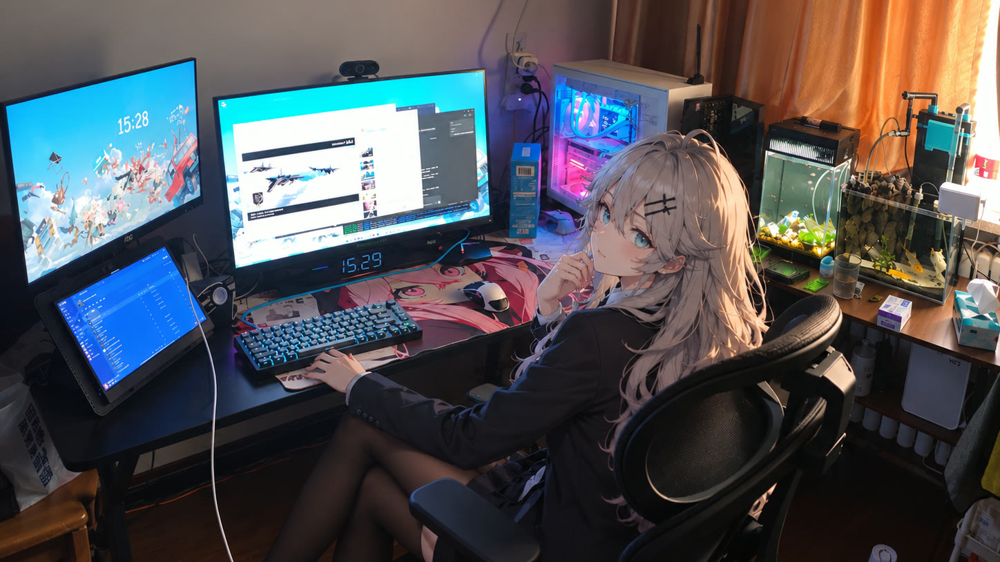

<p align="center">
  
</p>

<h1 align="center">AG99</h1>

<p align="center">
  <strong>点燃自己的历史。</strong>
</p>

<p align="center">
  <strong>一个以持续人格为核心、支持自然交流与复杂任务协作的开源 AI 智能体项目。</strong>
</p>

<p align="center">
  基于 AstrBot 深度扩展，探索持续对话、非阻塞任务执行、结构化上下文与受控主动交互。
</p>

<p align="center">
  <code>Desktop-first</code> ·
  <code>Persona-first</code> ·
  <code>Concurrent Interaction</code> ·
  <code>Bounded Initiative</code>
</p>

<p align="center">
  <a href="#项目特色">项目特色</a> ·
  <a href="#快速开始">快速开始</a> ·
  <a href="https://github.com/murphys7017/AG99live">AG99live</a> ·
  <a href="./docs/Yakumo/README.md">技术文档</a> ·
  <a href="https://github.com/murphys7017/AstrBot/issues">问题反馈</a>
</p>

<p align="center">
  
</p>

---

## 关于 AG99

**AG99 是一个从 [AstrBot](https://github.com/AstrBotDevs/AstrBot) 演进而来的开源 AI 智能体项目，专注于持续人格、低延迟交互与复杂任务执行。**

我们希望探索一种不同于传统聊天机器人的交互方式。

在传统的 AI 助手中，一次对话往往也是一次完整的任务执行。用户发出指令，Agent 开始思考、调用工具，直到任务完成后才返回结果。

对于日常工具来说，这种方式已经足够。但如果我们希望 AI 成为一个长期相处的虚拟伙伴，它就不应该只能在“聊天”和“工作”之间反复切换。

**我们希望，你可以让 AI 去完成一项复杂工作，同时继续自然地与它交流，而不必因为新的对话中断正在进行的任务。**

为了实现这样的交互，AG99 重新组织了 AstrBot 的部分运行流程：

- 由 **Personal Runtime** 维护持续的人格交互与会话状态。
- 由 **Core** 承担复杂任务，并逐步支持不同执行器。
- 通过 **Persona Expression** 统一角色对外的表达。
- 通过 **Structured Prompt** 精确组织不同阶段的模型上下文。
- 通过 **Observation Runtime** 实现具有明确约束的主动观察与交流。

AG99 以桌面陪伴为主要应用方向，但并不局限于桌面。项目继续兼容 AstrBot 的消息平台、模型 Provider、插件、Dashboard 和 CLI 等基础设施。

结合 [AG99live](https://github.com/murphys7017/AG99live)，AG99 还可以通过实时语音、Live2D 表情与动态动作，将持续的人格交互转化为更加自然的虚拟角色体验。

---

## 项目特色

### 1. Personal Runtime：持续存在的人格交互

**AG99 将 Persona 视为持续存在的交互主体，而不仅仅是一段用于控制回答风格的 Prompt。**

为此，我们引入了 Personal Runtime，用于维护跨多轮对话的交互状态、会话协调、即时表达以及受控主动行为。

在这套设计中，Persona 不再与某一次独立的 Agent 执行完全绑定。

同一个角色可以参与不同的对话、接收任务结果，并根据当前交互状态组织自己的表达。

我们也将几个容易混淆的概念分开管理：

- **Persona**：角色身份及其表达规则。
- **Session**：用户、平台与交互范围的隔离。
- **Conversation**：实际发生的对话历史。
- **Memory**：经过整理、可供后续交互使用的记忆信息。
- **Core Execution**：复杂任务的执行过程与结果记录。

这些信息各自承担不同的职责，共同为连续交互提供基础。

AG99 并不要求每一次回复都启动完整的复杂 Agent 工作流。对于普通交流，Personal 可以使用更轻量的表达流程，让角色尽可能及时地回应用户。

我们希望 AI 不只是记得上一句话，而是能够在持续相处中保持自己的身份与表达方式。

### 2. 持续对话与并行任务：交流不必等待工作结束

**你可以让 AI 去完成工作，同时继续和它聊天。**

这是 AG99 在交互体验上重点探索的方向之一。

传统的 Agent 工作流通常以一次请求为单位运行。当一个任务需要长时间执行，例如分析代码、检索大量资料或处理多步操作时，用户往往需要等待执行结束，才能继续与它进行普通交流。

AG99 将人格表达与复杂任务执行分离，并为 Core 建立独立的任务准备、运行协调和生命周期管理机制。

在普通消息处理中，Personal 的即时表达与独立 Core Router 可以并行工作。Core Router 负责判断当前请求是否需要进一步执行，Core Planner 则在路由后准备相应任务。

这为更灵活的交互提供了基础。

例如：

> **用户：** 帮我检查一下这个 GitHub 项目的代码结构。
>
> **AG99：** 好，我来检查一下。
>
> *Core 开始分析仓库。*
>
> **用户：** 对了，你觉得我们之前讨论的那个功能怎么样？
>
> **AG99：** 我觉得那个方向可以继续考虑，尤其是交互上的部分……
>
> *原有代码分析任务继续执行。*
>
> **AG99：** 刚才的仓库分析已经有结果了，我发现了几个值得调整的地方。

这段只是目标交互场景示例，不是实测对话记录。

在这种交互方式下，用户不需要一直等待任务完成，也不必为了继续普通交流而主动取消当前工作。

Core 的进度和最终结果可以重新回到 Persona 表达链路，在适当的时机反馈给用户。

这与严格意义上语音同时收听和说话的“全双工对话”不同，更准确地说，它是一种**面向持续交流的非阻塞交互与并发任务执行机制**。

目前，AG99 已经具备相应的分层运行结构、任务生命周期与结果回流基础。长任务运行期间的连续多轮聊天、取消和结果仲裁等场景仍需要进一步完成真实环境验证。

### 3. Core：不再绑定单一的任务执行方式

对于复杂工作，我们希望 AG99 不必永远依赖同一种 Agent 实现。

项目对 Core 的执行接口、任务准备、生命周期和结果回传进行了重新组织，将任务执行与外部人格交互逐步解耦。

Core 可以负责：

- 工具调用、信息检索和知识库查询。
- 多步骤任务规划和执行。
- Skills、SubAgent 及其他能力协作。
- 执行进度、结果和错误的记录与回流。
- 不同任务执行器的接入与选择。

当前 AG99 保留了基于 AstrBot 的原生 Native Agent，并已初步接入 Codex CLI 执行器。

我们希望未来能够接入更多执行方案，根据不同任务的特点选择合适的执行后端，而不需要重新实现整个人格与对话系统。

例如，普通工具任务可以使用内置执行器，代码开发可以委托专业编码执行器，其他复杂工作也可以由相应的外部执行服务承担。

**执行器可以不同，但与用户交流的仍然是同一个 Persona。**

目前 Native 与 Codex CLI 已具备相应的注册和执行协调机制，但执行器间的完整输出一致性、外部增量内容交付与稳定性仍在完善中。

### 4. Persona Expression：让同一个角色贯穿整个交互过程

AG99 不希望角色在普通聊天时具有鲜明性格，一进入任务执行就突然变成只会输出工具日志的程序。

为此，我们将 **Persona Expression** 作为用户可见自然语言的统一表达入口。

无论信息来自日常对话、插件、任务进度还是 Core 最终结果，都可以经过统一的角色表达机制进行组织。

这让 Persona 不再只是某个模型调用附带的性格提示词，而成为整个系统对外交流的统一边界。

同时，AG99 支持结构化的 Persona 表达结果，为语音、动作、情绪及其他表现能力提供扩展空间。

例如，配合 AG99live 时，角色可以通过语音和 Live2D 动作同步表达，而不必要求每一种底层任务执行器都理解具体的动作协议。

**复杂任务由 Core 完成，如何向用户表达则由 Persona 负责。**

这也是 AG99 将人格交互与任务执行分离的重要原因。

### 5. Structured Prompt：更加可控的上下文系统

随着智能体功能不断增加，系统需要处理的上下文也越来越复杂。

Persona、对话历史、长期记忆、工具、知识库、插件以及任务执行记录，通常具有不同的用途。

简单地把所有信息拼接到一段 Prompt 中，不仅容易造成冗余，也难以控制不同模型调用究竟能够看到哪些内容。

AG99 因此重构了 Prompt 系统，建立了结构化上下文收集、构建、目标投影与渲染机制。

现在，模型所需的信息会先被组织为具有明确来源和用途的结构化事实，再按照不同任务阶段进行筛选。

例如：

- **Persona** 主要接收角色身份、对话上下文、记忆及待表达内容。
- **Core Router** 使用受限的当前请求信息判断是否需要执行任务。
- **Core Planner** 根据路由结果整理具体任务。
- **Core** 接收工具、知识库、执行上下文和任务规格。
- **Personal Policy** 使用经过约束的观察事实进行主动策略判断。

不同阶段不会无条件共享全部上下文。

这不仅有助于降低无关信息的干扰，还使系统能够更清楚地管理数据来源、上下文版本和模型可见范围。

与此同时，结构化上下文为减少重复采集、优化 Token 使用与提高模型缓存命中率提供了基础。

AG99 也提供相应的构建耗时和缓存诊断机制，帮助进一步分析 Prompt 的性能。

**我们希望 Prompt 从不断增长的字符串，演进为可以明确组织、投影、检查和复用的上下文系统。**

### 6. Observation：受控的主动观察与交流

**长期陪伴不应该完全依赖用户每次主动发出指令。**

AG99 引入了后台常驻的观察与主动交互机制，让系统能够在普通消息之外接收和处理结构化观察事件。

观察信息可以进入 Personal Runtime 的状态管理流程，再经过事件聚合、Gate 判断和 Policy 策略评估。

但系统不会因为观察到一个事件，就立即调用工具或发送消息。

主动行为需要满足明确的约束条件。

目前相关机制包含：

- 有界的观察事件缓存与聚合。
- 主动行为的准入和策略判断。
- 冷却时间与静默时段。
- 主动输出预算与重复内容抑制。
- 延后事件的重新评估与唤醒调度。

这些机制让 AG99 可以探索一种更加自然的主动互动方式，同时避免系统无节制地打扰用户。

例如，未来可以通过插件接入更多桌面环境事件，让角色在合适的情况下主动发起交流。

AG99 当前的主动观察与表达机制已接入主要运行链路，但具体主动互动效果仍取决于观察来源、策略配置和实际部署环境。

我们的目标是让角色**可以主动，但不会失去边界**。

---

## 长期记忆与连续状态

持续人格不仅需要统一的表达方式，也需要能够使用历史信息与当前状态。

AG99 将准确的对话历史、抽象记忆、Persona 状态和 Core 执行记录分别管理，让不同来源的信息以适当的方式参与后续交互。

通过兼容的长期记忆、自学习和其他社区插件，角色可以进一步积累与用户的共同经历。

### NeuroBrain：连续内在状态实验

除了记忆，我们还开发了独立的实验性深度学习项目 [NeuroBrain](https://github.com/murphys7017/NeuroBrain)。

NeuroBrain 基于 **CfC 连续时间神经网络**，使用特定角色的对话序列数据进行训练，尝试学习外部刺激、内部隐状态与情绪及行为倾向之间的动态关系。

模型通过持续传递的隐状态保留此前刺激的影响，为角色提供随交互变化的数值状态，而不是每次对话都独立生成一组情绪标签。

它可以通过 [NeuroBrain Plugin](https://github.com/murphys7017/astrbot_plugin_neurobrain) 接入 AG99，为 Persona 表达和 AG99live 的角色表现提供状态参考。

NeuroBrain 是可选的实验性扩展，并非 AG99 的必需依赖，也不代表对真实心理活动的模拟。

---

## AG99live：为 AI 提供更加自然的表达方式

<p align="center">
  <a href="https://github.com/murphys7017/AG99live">
    <strong>AG99live — Live2D AI 虚拟陪伴项目</strong>
  </a>
</p>

AG99live 是与 AG99 协同开发的开源桌面虚拟角色项目，专注于实时语音、Live2D 动作生成与自然交互。

传统 Live2D 桌宠往往依靠关键词或固定规则触发预设动画。

AG99live 则通过语言模型、语义动作生成模型和实时动作引擎，使角色能够结合对话内容与状态动态组织表情、视线、姿态和连续动作。

我们还训练了专门的 Live2D 语义动作生成模型，并将 GGUF 版本公开发布：

[Live2D Expression Model — GGUF](https://huggingface.co/AkiPolaris777/live2d-expression-model-gguf)

在协同运行时：

- **AG99** 负责 Persona、对话、记忆、任务执行和主动策略。
- **AG99live** 负责本地交互、语音播放、Live2D 动态表现和桌面设备连接。

AG99live 不需要在桌面端重新实现完整的智能体系统，而是通过 Adapter 与 AG99 的输出及交互链路协作。

AG99 也能够在没有 AG99live 的情况下，通过消息平台、WebUI 和 CLI 运行。

[查看 AG99live 项目](https://github.com/murphys7017/AG99live)

---

## 基于 AstrBot，保留开放的插件生态

AG99 基于 [AstrBot](https://github.com/AstrBotDevs/AstrBot) 源码进行扩展和独立演进。

我们并不希望为了实现新的交互架构，就重新开发一整套成熟的智能体基础设施。

因此，AG99 继续复用 AstrBot 的平台适配器、模型 Provider、Pipeline、插件 API、Dashboard 和 CLI 等基础能力。

这意味着用户仍然可以利用 AstrBot 社区的扩展生态，为系统增加长期记忆、自学习、知识库、工具调用及其他功能。

### AG99 与官方 AstrBot 的区别

| | 官方 AstrBot | AG99 |
| --- | --- | --- |
| **主要定位** | 通用 AI Bot 与 Agent 平台 | 持续人格交互与任务协作 |
| **交互方式** | 以消息、Agent 和插件能力为基础 | 引入持续的 Personal Runtime |
| **任务执行** | 内置 Agent Runner 与工具体系 | Personal/Core 分层，并扩展执行器边界 |
| **Persona** | Agent 可配置的角色能力 | 用户可见表达的统一主体 |
| **上下文管理** | 通用模型请求与上下文管理 | 结构化事实、目标投影和分阶段渲染 |
| **主动交互** | Bot、插件和任务扩展能力 | Observation、Gate、Policy 组成受控主动链路 |
| **交互载体** | 消息平台、WebUI 等 | 桌面优先，保留多平台接入 |

AG99 并不是官方 AstrBot 的稳定替代版本。

由于项目已经修改了部分内部运行流程，与上游保持插件和基础设施兼容并不代表所有实现细节完全一致。

如果你希望快速部署一个成熟的通用 AI Bot，[官方 AstrBot](https://github.com/AstrBotDevs/AstrBot) 仍然是合适的选择。

如果你对持续人格、并发交互、结构化上下文和可扩展任务执行感兴趣，可以尝试 AG99。

---

## 快速开始

AG99 当前主要通过源码方式部署。

### 环境要求

- Python 3.12+
- [uv](https://docs.astral.sh/uv/getting-started/installation/)
- 可用的模型 Provider 或本地 LLM 环境

部分可选扩展可能存在额外依赖。

例如，当前 NeuroBrain 的进程内集成使用 PyTorch，相关 CUDA 依赖主要面向 Windows AMD64 和 Linux x86_64/aarch64 环境。其他平台需要根据依赖支持情况单独配置。

### 安装与启动

```bash
git clone https://github.com/murphys7017/AstrBot.git
cd AstrBot

uv sync
uv run main.py
```

启动后，默认通过以下地址访问 Dashboard：

`http://localhost:6185`

首次启动生成的账号与密码将输出至控制台。

进入 Dashboard 后，可根据需要配置模型 Provider、消息平台、Persona 及插件。

### 开发 Dashboard

```bash
cd dashboard
pnpm install
pnpm dev
```

更多配置与部署说明：

- [源码部署指南](./docs/zh/deploy/astrbot/cli.md)
- [消息平台接入](./docs/zh/platform/start.md)
- [完整基础文档](./docs/README.md)

---

## 项目状态

AG99 正在持续开发中。

目前，Personal Runtime、Persona Expression、Structured Prompt、Observation 和 Core 执行分层已经进入主要运行链路。

Native 与 Codex CLI 执行路径也已建立初步的协调和结果回流机制。

现阶段主要工作集中在实际运行稳定性、任务生命周期、并发交互、输出一致性和多执行器能力的进一步完善。

尤其是长时间 Core 任务运行期间的连续聊天、跨多轮任务状态保持、外部执行器增量输出和取消恢复等场景，仍需要进一步进行端到端验证。

因此，AG99 当前仍更适合实验、开发和个人场景使用。对于需要高稳定性的生产部署，建议先完成真实环境测试。

### 后续方向

- 完善对话与后台任务并行时的交互协调。
- 继续扩展 Core 执行器，并统一结果与状态回流。
- 优化 Structured Prompt 的构建性能、缓存与 Token 消耗。
- 扩展后台 Observation 的信息来源与主动交互能力。
- 改善与 AG99live 的语音、动作和状态协同。
- 持续保持 AstrBot 生态兼容，并选择性吸收上游改进。

---

## 技术文档

README 主要介绍项目特色与使用方式。

关于内部协议、模块职责、代码实现和具体开发状态，请参考以下文档。

| 文档 | 内容 |
| --- | --- |
| [项目身份](./docs/Yakumo/project-identity.md) | AG99 的定位与兼容边界 |
| [架构入口](./docs/Yakumo/README.md) | 整体设计与主要运行流程 |
| [Interaction Middleware](./docs/Yakumo/modules/interaction.md) | Personal Runtime 与交互协调 |
| [Prompt Module](./docs/Yakumo/modules/prompt.md) | Structured Prompt 与上下文渲染 |
| [Agent Modules](./docs/Yakumo/modules/agent.md) | Core、Agent 与执行器 |
| [当前实现状态](./docs/Yakumo/current-state.md) | 已实现能力与已知限制 |

---

## 项目与相关生态

| 项目 | 主要用途 |
| --- | --- |
| [AG99](https://github.com/murphys7017/AstrBot) | 持续人格与智能体运行核心 |
| [AG99live](https://github.com/murphys7017/AG99live) | Live2D 实时交互与角色表现 |
| [NeuroBrain](https://github.com/murphys7017/NeuroBrain) | 实验性连续状态神经网络 |
| [NeuroBrain Plugin](https://github.com/murphys7017/astrbot_plugin_neurobrain) | NeuroBrain 的 AG99/AstrBot 集成 |
| [AstrBot](https://github.com/AstrBotDevs/AstrBot) | 上游项目与开源插件生态 |

---

## 关于 AG99

**「点燃自己的历史。」**

AG99 的命名灵感来自 SCP 基金会中文分部作品 [《SCP-CN-1559》](https://scp-wiki-cn.wikidot.com/scp-cn-1559) 中的「异学九十九」（AG-99）。

我们将「点燃自己的历史」作为这个项目的理念。

我们希望，一个长期陪伴的虚拟角色不必只是持续等待指令的程序。

它可以与用户交流、参与日常生活、协助完成工作，并通过记忆与状态机制，让过去的互动对未来的交流产生影响。

每一次对话、每一次任务、每一次共同完成的事情，都有机会成为一段值得保留的历史。

AG99 并不试图宣称 AI 已经拥有真实意识或人类情感。

我们只是希望，通过持续人格、结构化上下文、可扩展执行与动态状态等技术，探索一种更加自然、连续，也更加实用的 AI 交互方式。

**让 AI 不只能够回答你，也能够陪伴你一起经历。**

---

## 许可与致谢

AG99 基于 AstrBot 独立演进，采用 **AGPL-3.0-or-later** 许可证，并遵守适用的第三方许可与兼容条款。

感谢 AstrBot 社区、插件开发者以及其他开源项目贡献者提供的基础设施和技术支持。

- [LICENSE](./LICENSE)
- [EULA](./EULA.md)
- [AstrBot 上游仓库](https://github.com/AstrBotDevs/AstrBot)
- [AstrBot 官方文档](https://docs.astrbot.app/)

---

<p align="center">
  <strong>AG99 · 点燃自己的历史。</strong>
</p>

<p align="center">
  让对话持续，让任务并行，让共同经历成为历史。
</p>