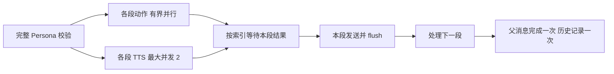

# 低延迟 Persona 分段投递方案

更新：2026-10-13。前两阶段已完成源码实现和定向边界验证，尚未重载服务或现场验收。

## 目标与指标

优先减少用户等待第一段声音的时间，同时减少末段准备完成时间。分别观察：输入到
首段实际投递、输入到末段投递、动作/TTS 各段就绪、失败/超时/取消。播放时长另算。
单段回复仍受 Persona、动作及 TTS 的单次请求耗时限制，不承诺固定秒数或倍数。

当前保留完整 Persona JSON/XML/Markdown 的统一校验：模型返回全部 segments 后才进入
以下流程。文本平台仍按 speech 顺序拼接一次发送；动作输入为文本对话、简单记忆、
speech/actions/tendency，以及已规范化的参考和合法能力数据。

## 阶段一：有界准备并行

- 动作沿用 independent_motion.parallel / max_concurrency，按索引发布每段 Future，
  全批任务仍可供整条消息消费者等待。当前实例已设置 parallel=true、max_concurrency=2。
- Core 对可增量投递的 Persona 音频分支同时准备最多两个 TTS 请求，统一走 synthesize_text
  及既有状态 hook；任务完成顺序不决定输出顺序。ID 在启动任务前按原顺序分配。
- 共享动作上下文在整轮创建一次。当前段的动作/情绪分别传入，不加入图片或额外记忆检索。

## 阶段二：逐段汇合与按序发送

首段准备时间近似为：Persona 耗时 + max(首段动作耗时, 首段 TTS 耗时) + 准备/投递开销。
后段先完成会保存在任务结果中，直到前段投递完成；第一段不等整批结果。

### Core 边界

- 仍先执行贡献采集、文本覆盖和装饰。supports_segment_materialization 是贡献者的显式
  准入声明；任何仍要求整条消息 finalizer 的贡献者都会保留原整条消息投递流程。
- 首批启用条件：平台实现 flush_visible_segment；非空 Persona result ID；纯 Plain
  消息；TTS 启用且触发概率为 1；无 reasoning 展示或 t2i；无预先附带 client_objects；
  有声明可逐段处理的 finalizer。其他消息继续由现有物化流程处理，附件不会被丢弃。
- 新增有序消息产物流，但 _deliver_visible_message 仍持有一个父消息的 delivery receipt。
  OLV 每个产物通过既有物理发送接口入队，然后 flush 本段；全部完成后才 complete 父消息。
- 普通文本平台仍得到一次拼接文本。OLV 音频段直接使用 Record 的分段文本，不额外重复
  发送整个 Plain 回显。原始 segment_index/count 保留，空段不生成音频。
- Record 及 TTS 失败后的 Plain 均在实际 delivery_metadata 顶层携带
  persona_segment_index/count，不能只把索引写入物化结果或嵌套 TTS 状态。
  插件使用这些字段选择本段动作；缺失时会拒绝使用带索引的动作。

### AG99live 边界

- Persona hook 创建按 _turn_id + persona_result_id 保存的 Future 表；每个动作任务完成后
  向对应 segment_index 发布结果。finalizer 收到段级 materialization 时只等待该索引。
- parent_message_id、message_id、tts_request_id 仍与动作显式绑定，不使用完成顺序或 FIFO。
  最后一个实际输出段完成后才移除整轮 work；普通整批 finalizer 保持一次汇合。
- OLV 的 flush_visible_segment 只调用现有输出协调器的 finalize_output_segment，不关闭
  parent 或 Turn。整轮 synth_finished / playback_finished 的原生命周期保留。
- Electron 的 getNextPlaybackReleaseSegment 优先返回当前可播放段，协调器在拿到段时
  不等待 synthFinished；播放完成协调器仍要求 synthFinished 才确认整轮结束。native
  runtime 的 SegmentAssembler 按连续序号立即发布 ready 段。这些前端条件无需改动，
  但源码检查不能代替实际声音播放验收。

### 失败与中断

- 某段 TTS 失败时保留该段文本和失败状态，继续处理后段；无相关状态的内部错误传播。
- 动作单段请求仍受插件 timeout 限制。段级 finalizer 共用一份绝对等待预算，不为每段
  重新增加整轮预算；超时允许文本/音频继续投递，动作缺失需现场检查其明确失败标记。
- 消费器退出时取消并回收尚未完成的 TTS 任务；动作仍归属于现有按 Turn 注册的任务组。
  首段已 flush 后中断，只记录已投递的文本前缀，不将尚未发出的后段写成已发送历史。

## 阶段三：Persona 按完整 segment 流式产出（尚未实现）

在首段对象完整且通过校验后启动该段动作/TTS，同时继续读取后续段，可进一步重叠
Persona 生成与输出准备。这要求明确逐段提交契约：已播放内容无法因后续 JSON 错误撤回。
必须先解决 turn_action 的确定性、段级字段校验、后续格式失败、工具调用/effect 执行边界、
模型取消和协议格式差异。不得直接播放未闭合的 JSON 或截断的 tool arguments。

本阶段不以流式 API 的存在作为已支持分段流式提交的证据，也不绕过最终规范校验。

## 验证与上线步骤

已通过：Core 公共投递边界的首段提前输出、首段后取消和单段 TTS 失败；插件公开
finalizer 的按段等待；OLV 公开发送/flush 接口不提前关闭父消息；普通分段 TTS 路径检查。
这些检查使用受控 Provider/平台端口，不能证明真实网络延迟、声音或 Live2D 播放正确。

下一步审阅提交后，同步插件并重启 Core，再以同一模型和上下文进行两段/三段实测。
验收顺序：正常播放 → 后段先就绪 → 首段后打断 → 动作超时 → TTS 失败 → 断连重置。
核对首段/末段时间、索引/ID、动作与音频同步、历史只有已发文本以及没有重复投递。
真实服务商的并发排队与限流可能抵消收益，应根据样本再调整并发数。
