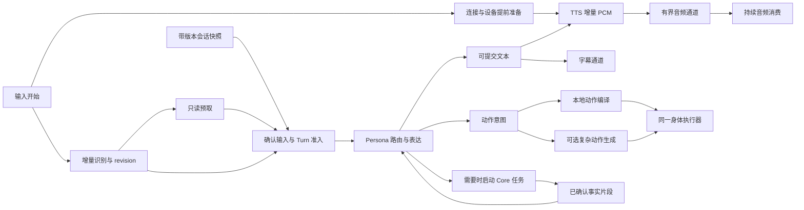

# OLV 全链路流式与低延迟架构执行任务书

日期：2026-10-17。面向执行模型：6.1 SOL。

**阅读入口：**先读 [14 剩余工作与现场验收](14-olv-remaining-work-and-acceptance.md)，再按需查阅本文架构、[09 行为细则](09-olv-implementation-playbook.md)、[10 历史证据](10-olv-runtime-evidence-2026-10-17.md)及 [11 非流式实施记录](11-olv-nonstreaming-optimization-plan.md#16-2026-10-17-本会话实施记录)。

**当前状态：**T0b/T1/T2/T3 已实现并完成局部验证，T0 观测与 T4 资源准备部分完成；真实 M2、首采样、连续段身体表现和负载验收未完成，T6/R6 动作小记录未实施。提交与边界证据见第 12、13 节。本文件第 2.6 节和原始审阅依据保留历史背景，不作为当前未完成清单。

## 1. 执行目标与授权边界

用户目标是：A 有可提交增量就推进 B，B 有可用结果就推进 C；尽量缩短首个有效文本、首个可听音频及首个有效动作的等待，同时保留自然连续的声音、动作同步和正确的取消收口。

执行范围以用户当前指令及既有授权为准；本会话已授权逐项实施、逐项提交。文档本身不授予发布、重启或中断用户正在进行的会话的权限，也不要求重复确认已有授权。

成功不是“所有 Provider 都设置 stream=true”，而是以下条件同时成立：

1. 首个安全文本记录不等待整个 Persona 完成；音频不等待完整文本、完整音频文件或动作生成。
2. 动作有可执行结果就进入同一 Turn 的身体执行边界；无音频时也能独立执行和结算。
3. 网络接收不等待实际播放排空；可选动作失败不能堵住文本和语音。
4. 各支路有界、可取消、可独立结束；无无人消费队列、重复播放、跨 Turn 污染。
5. 对真实链路提供同配置基线和改造后数据；无法现场验证时明确标记缺口。

不在本次默认范围：更换整套 Agent 架构、重写全部 Provider、引入第二个人格/记忆宿主、改造 C++ native runtime、升级无关依赖、批量修改人格文案、发布或删除旧部署。

## 2. 仓库、文档与事实来源

### 2.1 工作位置

| 标识 | 位置 | 职责 |
| --- | --- | --- |
| Core | `C:/Users/Administrator/Downloads/AstrBot` | 输入、Persona、Core 执行、上下文、安全预处理、TTS、语义交付 |
| Live | `C:/Users/Administrator/Documents/GitHub/AG99live` | Adapter 源码、Electron/TypeScript 桌面、音频时间线、身体表现 |
| 部署副本 | `Core/data/plugins/astrbot_plugin_ag99live_adapter` | AstrBot 实际加载的插件副本，不是独立开发主仓库 |

开始时读取两个仓库的 `AGENTS.md` 和 `.ai/index.md`，记录 HEAD、分支、相关 dirty files。先改源码主仓库，再按已有同步方式核对部署副本；不能只修部署目录。旧安装包目录不能当作 Live 源码根目录。

文档落盘时 HEAD：Core `93ab37ae5`，Live `f3ffc88`；审阅对象还包含 Core 未提交修改，不能把 HEAD 当作完整工作区快照。此版本记录只用于定位，不要求后续执行者切回这些提交。

审阅时 Core 已有用户未提交改动：`astrbot/core/interaction/output_controller.py`、`tests/unit/test_persona_segment_stream.py`、`.jspace/history.json`，另有 `.codex-temp/`。这些只是当时的快照，执行时重新检查；不能覆盖、回退或顺手提交。

### 2.2 必读资料

- 本目录 `07-low-latency-segment-delivery.md`：旧阶段背景，不能据其中“阶段三尚未实现”推断当前实现。
- Live：`docs/02-设计文档/12-OLV全生命周期流式实施计划.md`。
- Live：`docs/02-设计文档/13-OLV增量输出事件与生命周期契约.md`。
- Core：`docs/Yakumo/modules/interaction.md`、`astrbot/core/persona_stream_policy.py`。

资料有历史条目和状态不一致时，以当前调用链及实际运行证据为准，再修正文档；不得用“文档说已接通”代替检查调用方。

### 2.3 当前审阅可信度

初次发现来自源码跟踪；第二次复核增加两轮运行日志和桌面播放事件，具体证据见 10 文档。新发现 R0 是真实日志已观察到的增量 writer 准入失败；R5 也出现 provider 阶段超时及取消，其余项目仍须按各自边界复核。抽查 Live 的 `main.py`、`platform_event.py`、`runtime/incremental_output.py`、`middleware/interaction_motion/independent.py` 与部署副本一致；这不证明运行中进程已经加载它们。执行者必须先复核缺陷仍存在，避免修复已变化的代码。

### 2.4 必须区分的三种输出模式

| 模式 | 主 Persona | TTS/桌面交付 | 识别方式 |
| --- | --- | --- | --- |
| M0：普通表达、分段物化 | 完整 Persona 结果后推进 | 各段动作/TTS 可并行准备，完整音频段投递 | 普通结果入口、segment_tts_ready、output.segment |
| M1：Persona 流、完整音频段 | JSONL 段逐步产生 | 完整段 TTS/旧物化投递 | Persona segment Hook 与 output.segment 同时出现 |
| M2：完整增量文本/PCM | JSONL 可提交文本逐步产生 | writer + text/audio/motion streams + 二进制 PCM | writer 准入成功、实际增量事件和 PCM 消费证据 |

`Provider stream=True` 不能单独证明 M1 或 M2；动作模型本身也使用聊天流。用户说“非流式”时先记录其含义，不假定全链路无任何并行。

02:00 的现场样本请求流式，却因 writer 身份绑定失败落到 M1；02:00:56 桌面同步设置为 False，02:02 样本为 M0。尚不能用这两轮评价 M2 的性能。用户报告后续普通模式体感约三秒，应作为需要保留和复测的产品表现；不能写成已测得 M2 比 M0 快，也不能用其他两轮数据否定用户未匹配到日志的后续样本。

### 2.5 记忆读取语义校正与最新实施约束

用户明确要求暂不改动复杂 Prompt 上下文系统，先研究以麦克风开始信号提前准备已有材料；文本输入检测暂不做。T5/T7 中涉及上下文结构、查询式召回、输入修订的扩展属于后续候选，不在当前优先实施范围。

已复核现有 Core Memory：`MemoryCollector` 调用 `MemoryService.get_prompt_snapshot`，读取本地已存在状态，并由 `RecallSnapshotManager.get_or_schedule` 返回可用缓存；缓存过期可返回同作用域旧结果，同时安排后台刷新，无缓存则使用本地快照。召回 query 来自已存短期记忆，不是当前尚未说完的用户原话。生产记忆更新在回合完成后以 `background_jobs=True` 提交，Prompt 不等待本轮分析/整理完成。因此读到上一轮甚至更早的已发布记忆是允许的设计语义，不应视为需要阻塞修复的过期错误。

不得把前文“问题相关检索必须等最终输入”的通用候选建议套到现有 Prompt Memory 读取路径，更不能新增等待后台刷新完成的屏障。显式记忆查询工具与普通 Prompt 快照读取应分开判断。麦克风开始可预读已有记忆材料；保留用户/会话/权限作用域与版本信息，不要求一有后台新版本就取消准备并等待最新版本。是否在最终组装时采用已自然就绪的新快照需按现有接口决定，不额外等待。

注意“不等后台更新”不等于读取零耗时：服务初始化、本地存储读取、身份解析和刷新任务入队仍有 await；不能把这些 await 当成正在调用记忆模型。语义记忆快照与正式对话历史也不是同一份数据，历史的新消息一致性仍按原契约处理。

### 2.6 非流式优化后的新执行基线

第三次复核的代码基线：Core `675083c81`，Live `15c174d`。Core 仍有原先的 `output_controller.py`、流式测试与 `.jspace/history.json` 未提交改动；Live 工作区干净。此处记录当前事实，不要求后续执行者切回这些 HEAD。

| 已有改动 | 流式任务如何承接 | 尚未证明的部分 |
| --- | --- | --- |
| Live `355ce34`：同一 SpeechOutputRuntime.prepare、冷准备去重、输入开始预热 | PCM attach 继续使用同一个输出图及 prepare；不要另建预热播放器或 AudioContext | 真实 M2 冷设备首采样收益 |
| Live `10e6dcd`：PTT/VAD 触发现有 Memory 服务及召回缓存预热 | 继续使用已有资源准备，正式 collector 重新读当前作用域；不缓存整份 Prompt | 缓存命中率、整体上下文等待是否下降 |
| Live `667e91b`：松手截图与设备停止/队列等待重叠 | 输入路径直接复用；ASR 与图片分离仍未做 | 截图本身及发送前剩余等待 |
| Core `dffae9430`：能力摘要省去无用 schema，保留相同准入 | M0/M1/M2 都沿用该摘要入口，不再做同一优化 | 配置下实际省时 |
| Core `e2ad65a09`：MiniMax 文件 TTS HTTP 连接池 | 只作用于完整文件合成；不得据此宣布 M2 bidi 已复用连接 | M2 WebSocket/task 的建立成本及复用合法性 |
| Live `4b76b5c`：M0 后到动作；`cf6bed2`：语音段动作交接；`daf0041`：pending 不被 speech-only 抢占 | 当前段动作接入已移到全局 blocker 前；保留 M0 交接和 speech-only 修正，继续完善 M2 特有状态 | 纯动作、PCM 失败/终止、后到更新及 M2 身体表现 |
| Live N0/N5 阶段计时和完整 Electron 构建 | 复用白名单事件、timeOrigin、streamId/messageId；补 M2 必要首事件 | 构建和普通边界检查都不是 M2 端到端验收 |

**协议不能混淆：**普通文件段已升级为 `output.segment.v6`，后到动作用 `output.segment_motion`；M2 仍为 `olv.incremental_output.v1` 的三资源流和二进制 PCM。不能用 v6 后到动作事件更新一个 M2 段，也不能给 M0 注册 PCM 流。后续 credit/动作修订扩展需单独同步两端契约与 handshake。

以上为非流式优化后、流式修复前的历史基线；后续实现以第 12、13 节为准。源码部署匹配与进程实际加载版本须分别记录。

## 3. 当前链路与应保留的能力

本节增量链路覆盖 OLV immediate Persona 调用；`delegate` 后的 Core-final 回复仍使用普通完整结果路径，不因同一 Turn 曾产生 M2 确认语音就变成 M2。`middleware._generate_and_emit_persona` 在该次流式调用的 finally 中清除 active，保留后续普通回复的 Hook/contributor 语义。验收应分别记录确认语音与最终结果的模式，不能将当前实现推广为全部回复均已流式化。

```text
麦克风分块 → 完整语音段/VAD 结束 → ASR → Turn 准入
  → 上下文准备 → Persona JSONL
      → header：确定 reply/delegate/silent
      → segment_start：动作意图及情绪
      → speech_delta：安全预处理 → 文本 writer
                                  → PCM 文本队列 → MiniMax 双向 TTS
                                      → PCM 帧 → Adapter → 桌面播放器
      → 动作异步任务 → 完整结果解析 → motion update
      → 各资源 end → synth_finished → 本地播放结算 → playback_finished
```

已经存在且应复用：Turn 所有权、execution_scope、路由准入、增量私有标记清洗、Turn 内上下文任务复用、插件上下文预取和 best_effort、二进制 PCM 身份及采样偏移校验、PlaybackTimeline、ModelEngine、播放完成回执、中断清理。

不要为了新架构再建立第二套 TurnCoordinator、会话状态库、语音播放器或人格决策器。

## 4. 审阅项与当前处理状态

| ID | 当前处理状态 | 原始问题与触发条件（历史） | 行为要求 |
| --- | --- | --- | --- |
| R0 | 已修复，待现场验收 | 真实日志出现 incremental_output_turn_binding_invalid，writer 不建立，回退 M1；Adapter 预绑定 message_id，而 Core 可独立创建 _turn_id，存在身份域不一致 | 普通输入通过真实 Turn 准入自然建立 frontend→Core 身份映射，M2 确实被执行；不得删除校验或在探针中手动预绑定掩盖问题 |
| R1 | 已修正，待现场验收 | Live 现先扫描运行中音频段并启动后到 motion，再检查全局 blocker；来自非流式 N4 改造。原“只在 blocker 后处理”的描述已过时，旧增量分支仍存在 | 保留修正，以真实 M2 验证不重复启动、无跨段串扰；不要重复搬动同一判断 |
| R2 | 已修复，待现场验收 | 同分支要求 audio.started；纯动作段或音频起播前失败时，有成功 motion payload 却无法执行/结算 | 支持独立动作时钟，或明确失败收口；不永久 pending |
| R3 | 已修复，待现场验收 | Core `emit_persona_segment_stream` 中 PCM consumer 失败退出，producer 继续向 maxsize=128 队列 put；结束/取消路径也 put sentinel | 音频失败后不再等待失去消费者的队列，文本继续，取消及时完成 |
| R4 | 已修复，待现场验收 | 同函数 segment_end 在增量 writer 存在时仍可进入旧 tts_segment 入队分支，而旧 delivery_task 未启动 | 每条活动队列有唯一活跃消费者；增量路径不向旧队列提交 |
| R5 | 已修复，待现场验收 | Live `resolve_stream_motion_budget_seconds` 返回 min(configured, 0.75)；context/gate/provider 共用期限 | 生产期限遵循配置及 Turn 剩余预算，音频无需等待动作；不以取消全部动作换首响 |
| R6 | 未实施，设计缺口 | Live `motion/text_stream.py` 等 Provider EOF 才返回，independent.py 随后解析 JSON | 可执行闭合记录经验证即提交，不等待整流 EOF |
| R7 | 已修复，待现场验收 | Live transport 串行 await onMessage，PCM handler 等前段排空/缓冲空间；队列超限直接断连 | 音频消费等待不阻塞文本、动作和控制；生产端接受容量反馈 |
| R8 | 已修复，待现场验收 | Core 计算 use_tts 后，增量 writer 分支仍无条件启动 PCM consumer 并喂入文本 | TTS 关闭/未准入时不发 Provider 请求，音频资源有明确空终态 |

补充性能项：设备约 350 ms 冷预热现可在麦克风开始时提前进行，播放前仍复核；不再将它一概描述为首 PCM 后才开始。segment_start 的完整 actions/tendency 位于首 speech 前、语义段 TTS flush、M2 MiniMax 会话建立和完整语音段 ASR 仍需测量。这些是优化候选，不能在缺少数据时认定每项都是主要瓶颈。文件 TTS 连接池与 M2 双向流连接不是同一个改动。

前端输入项已部分实施：截图现从松手时启动，与设备停止/排队重叠，end 信封仍等图像且整体发送后才触发 ASR。停止、队列、截图、发送现已有分项打点。775/799 ms 是改动前两轮的观测窗口，不能继续当作当前延迟，也不能全部归因于截图。T0 复用新事件采集当前数据。

R0 身份修复已通过真实本地输入入口验证；R2–R5、R7–R8 已有后续修复，证据及限制见第 12、13 节。Core 用户修改中的 contributor 判断位于 OLV policy 提前返回之后，不能据此断言 OLV 必定被拒绝，也不能擅自还原用户改动。

优先级解释：R0–R5、R7–R8 中的挂起/错误准入/调度属于正确性修复；R6 是相对全流式目标的设计缺口。P1 不代表所有架构任务都要在首批一起实现。T6–T8 必须过收益与依赖门槛，不以任务列表存在为理由无限重构。

## 5. 目标架构与强制不变量

### 5.1 目标依赖图



图中预取不是所有输入都必须等待的屏障。只有本轮回答所必需的依赖进入关键路径；可选结果按预算采纳。

### 5.2 不变量

1. Persona 仍是语义表达权威，AG99live 只决定身体如何执行合法意图，不自行生成第二套回答、记忆或主动策略。
2. 文本显示和 TTS 消费同一份已清洗、已接受的文本。禁止未闭合 JSON、私有标记、未校验动作参数直接执行。
3. 保留 `turn_id/core_turn_id/persona_result_id/segment_index/stream_id/seq` 的显式关联，禁止以完成顺序或 FIFO 猜归属。
4. 已发送文本、已播放采样不可撤回或重放。失败保留真实前缀，不能伪造整轮成功。
5. 生产 EOF、播放排空、语义任务完成是不同状态。保持各自所有者和单次终态，不把一种结束当成全部结束。
6. 队列同时限制条数和字节/采样量，取消必须唤醒所有等待者；数据不得静默丢弃。
7. 可选动作失败不覆盖成功文本/语音；纯动作段的动作失败仍需有真实失败状态。
8. speculative 工作限于可撤销、只读准备；未经最终准入不得执行外部写操作或播出猜测答案。
9. 不靠跳过安全检查、内容截断、固定应答填充或取消正常动作来伪装性能改善。
10. 内部替换路径在调用方迁移后删除；只有明确外部兼容需要才保留兼容入口，并记录消费者及退出条件。

## 6. 分阶段任务

所有任务先查实际调用链，再实施；不得仅因表格标为待办就重复添加已有功能。建议状态枚举：pending / implementing / source_verified / boundary_verified / live_verified / blocked。缺少现场环境只能停留在对应验证级别。

### T0：冻结可比较基线与观测点

**依赖：无。产物：当前链路图、版本记录、延迟事件定义及可用基线。**

- 记录 Core HEAD、Live HEAD、部署文件哈希、桌面构建版本及运行进程是否加载这些版本。
- 只记录模型/音色标识与必要设置，不输出凭据或整段私密聊天。
- 关联时间点：输入起止、ASR final、必需上下文就绪、Persona request/first chunk/first committed text、TTS connect/task ready/first PCM、Adapter 首帧、桌面首采样、motion intent/first valid update/actual start、各资源结束、播放排空、Turn 结束。
- 同进程 duration 使用 monotonic；跨进程事件使用关联 ID 和 epoch，记录时钟误差，不能直接相减不同进程的 performance.now。
- 区分首个网络 chunk、首个有效语义内容、软件消费首采样和硬件实际发声。没有环回录音时，不把软件时钟称作硬件测量。
- 若没有可运行基线，记录原因并继续静态修复；不得补造改善百分比。

### T0b：修复真实入口的 Turn 身份绑定与模式诊断

**依赖：T0 的证据检查。对应 R0；在声称任何 M2 优化有效前必须完成。**

入口：Adapter `runtime/turn_coordinator.py::_commit_inbound_message/_resolve_backend_turn_id/open_incremental_output`、`runtime/turn_identity_map.py`、`platform_adapter.py::open_incremental_output`；Core `interaction/turn_context.py::PlatformTurnContextFactory.create`、`turn_state.py::ensure_interaction_turn_state`。

- 列出 capture/input/message/frontend/Core/Persona 身份的生产者、赋值时点和消费者。不要把 message_id 与 Core _turn_id 默认为同一个域。
- 找到真正 Core Turn 创建后的可靠绑定边界；复用现有生命周期通知/端口，或在入口统一一个已被 Core 接受的身份，选择需由实际调用链决定。禁止在任意发送失败时临时重绑。
- 如果映射缺失、冲突或已过期，明确区分 reason；不能移除当前有效 Turn、连接、终态校验。
- 每轮记录 requested_mode、selected_mode、fallback_reason、有效配置 revision 与两个 Turn ID。降级之前须确认无增量数据已对端可见；已经部分发布不得转为旧段重放。
- 保留已有普通模式用户设置，不擅自打开流式。部署修复时明确哪些进程需加载新代码。

验收：由正常文本或音频输入创建事件，经实际 Core 准入再到 writer，不事先手填映射；正常 case 进入 M2，过期/错误绑定仍拒绝。抓取实际 text/audio/motion start/end 及首 PCM 证据，不能仅看设置 True 或 Provider stream=True。

### T1：修复生命周期、TTS 准入和队列所有权

**依赖：T0 的身份/观测定义，T0b 必须在真实 M2 验收前完成。对应 R3、R4、R8。**

主要入口：Core `astrbot/core/interaction/output_controller.py`、`astrbot/core/voice/pcm_stream.py`；Adapter `runtime/incremental_output.py`、`platform_event.py`。

- 为 PCM 支路明确 running/completed/failed/cancelled 状态。enqueue 必须同时观察消费者终态；不能只检查一次 done 后无限 put。
- PCM 失败后停止喂入音频队列并关闭对应资源；文本继续完成。实现有限时间的任务清理，不在取消处理中阻塞写 sentinel。
- 避免 audio end 的重复发送与终态重写；后续段在音频已不可用时也必须明确收口。
- 增量路径移除旧物化队列提交；旧路径仅在明确准入条件下独立运行。
- 按 use_tts 准入创建 Provider 任务，关闭 TTS 时不连接；保留文本/动作资源及音频空终态。
- 首段输出后模型失败、TTS 提前结束和用户取消，都要保留已接受前缀并正确清理所有任务。

验收：公共输出入口的正常增量交付；PCM 早期失败后持续超过队列容量的合法文本仍完成；有界等待期间取消能返回；关闭 TTS 不发生语音请求。对旧队列遗留问题，使用合法多段输入复核并确保末尾结束标记也不挂起。优先复用已有边界设施，不为每个内部字段新增测试。

### T2：动作调度与生产预算解耦

**依赖：T1 的终态约束。对应 R1、R2、R5。**

入口：Live `frontend/src/turn-playback/useTurnPlaybackOrchestrator.ts`、`selectors.ts`、`session.ts`、`frontend/src/playback-timeline/playbackTimelineRuntime.ts`；Adapter `main.py`、`middleware/interaction_motion/independent.py`。

- 区分“其他段阻止开启新段”和“本段允许添加 motion sink”，不能移除全局顺序保护后造成跨段抢播。
- 音频起播后允许本段动作立即启动；纯动作段使用现有独立时间线能力。音频失败时明确决定动作是否仍可执行，不能无限 pending。
- 对已过期动作设置取消/拒绝规则；不要在后段已播放时突然补播旧段动作。
- 移除配置值被 0.75 秒硬封顶的逻辑。生产期限来自配置和 Turn 剩余预算；交付等待不另行截断正常生成任务。
- 复核 Core `finish_motion` 的固定 1 秒等待，统一到一份明确动作期限/结算策略，避免移除 0.75 秒后仍被另一个硬超时取消。
- 动作未到不阻挡音频；音频结束后动作仅可在有界合法窗口继续，窗口结束必须结算并释放注册表。

验收：动作在本段音频期间启动；纯动作段执行并完成回执；动作耗时超过旧阈值但未超过配置预算仍可生效；超时、迟到、打断后结果不污染后续段。

### T3：独立通道和端到端容量控制

**依赖：T1、T2。对应 R7。此任务包含协议边界变更。**

入口：Live `frontend/src/adapter-connection/core/transport.ts`、`inbound/adapterInboundRuntime.ts`、`inbound/incrementalOutputRuntime.ts`、`frontend/src/turn-playback/incrementalSegments.ts`；Adapter writer/transport/output coordinator。

- 接收层完成身份、序号和有界 admission 后分发，不在网络回调等待数秒播放排空。
- 为 audio、text、motion、control 明确队列和调度规则；保留 start 在 data 前、end 在本流数据后，跨资源无必要的等待解除。
- 引入消费容量反馈，单位优先为 PCM 采样/字节，并另限消息条数；区分“已经接收”“已经缓冲”“已经播放”。
- 服务端无 credit 时暂停相应音频生产/发送，不阻塞控制帧或文本；不在持有 Turn 全局锁时等待 credit。
- control.interrupt、断连清理和 credit 更新不得排在已满音频队列后形成死锁。
- 控制消息不能任意超车：保留 turn_started、身份绑定、终态的因果顺序。信用信息绑定连接和 Turn 代次，重连不继承旧额度。
- 限制上游 PCM 缓冲，不能只把桌面无界积压搬到服务器；读 socket、调度和音频设备之间均须明确上限。
- 先更新两端契约与能力准入，再启用新发送路径；不让旧客户端误接收不支持的消息。

验收：快生产/慢播放时内存有界，文本和动作仍及时处理；credit 枯竭时中断和关闭能完成；重复 credit/迟到数据不增加额度、不重播；EOF 后排空再回执一次。

### T4：提前准备连接与设备

**依赖：T1；可在 T3 前独立完成。**

入口：Core `astrbot/core/provider/sources/minimax_bidi_stream.py`；Live `frontend/src/playback-timeline/speechOutputRuntime.ts`、`pcmTimelinePlayback.ts`。

- 把音频设备 prepare 提前到合适的输入/流开始信号，与模型生成重叠；prepare 本身不计作起播。
- 将连接准备、任务准备、文本提交拆为可观测状态。优先实现提前建立本轮连接，再评估跨轮池化，不默认服务商支持重复 task。
- 复用合适的 HTTP session/连接资源必须明确凭据、endpoint、proxy、voice、model 的隔离和生命周期。
- 一条 TTS 合成任务只拥有一个当前 Turn。取消未确认前不得交给下一轮，不能复用有歧义的音频归属。
- 提前准备没有被使用时释放资源；计入额外连接和 Provider 费用，避免无限预热。

验收：冷/热启动分别比较首采样；预热与模型时间确实重叠；取消预热不泄漏连接；音色/模型切换不串配置。Provider 会话复用能力必须按官方资料及实际接口验证，不能猜测。

### T5：会话快照、依赖任务图和前台资源预算

**依赖：T0，保持现有上下文来源和安全边界。**

入口：Core `interaction/context_builder.py`、`interaction/expression_agent.py`、`prompt/builder.py`、`memory/snapshot_builder.py` 及实际 collector/capability resolver。

- 先列出每项上下文输入依赖、作用域、读取耗时和是否影响当前问题正确性，再拆并行任务；禁止无依据地全改 gather。
- 为基础 Persona、近期摘要和能力摘要建立版本化快照，复用已有 Turn task 去重；会话、Persona、权限、插件和模型资源变化时失效。
- 身份/权限等准入项必须读取有效状态，不能以陈旧快照绕过撤权；记忆不得跨用户/会话泄漏。
- 将上下文分为 required、optional、post-turn。问题明确依赖的记忆/图像属于 required；不能为了首响省略关键事实。
- optional 按有界预算采纳已就绪数据；晚到信息只能进入下一次明确的模型请求，不能声称修改了已在推理的 prompt。
- 稳定静态提示词前缀，动态本轮材料放在适当位置；记录输入 token、构建耗时及可用的缓存命中数据。
- 给前台 Persona、首段 TTS、持续音频补给、可选动作、后台记忆任务分配预算。共享 GPU/连接池/模型限流时保护前台，仍需防止后续音频饿死。
- 后台持久化只后移非交付关键工作；已发前缀、取消和历史一致性所需的可靠记录不得随意改成 fire-and-forget。

验收：同输入的必需上下文保持一致；无关慢插件不挡普通聊天；记忆问题仍获得所需召回；切换 Persona/权限立即生效；负载下首响与断音率同时观察。

### T6：动作小记录与本地身体编译

**依赖：T2；增量修订依赖 T3 的协议顺序。对应 R6。**

入口：Adapter `motion/text_stream.py`、`middleware/interaction_motion/independent.py`、`motion/performance_curve.py`、现有 motion payload validator；Live ModelEngine、Profile、动作时间线。

- 先定义可独立校验并执行的动作小记录：identity、revision、操作、合法参数、anchor、有效窗口。完整小记录到达即验证/提交，不等整流 EOF。
- 不能简单截取半截旧 JSON；需要正式 producer prompt/contract、增量 parser 和消费者同时迁移。
- 完整动作结果仍保留聚合审计，但不能再次播放之前已提交的动作。失败不撤销已经执行的合法前缀。
- 高频动作采用 Persona 意图 → 本地确定性编译 → 当前模型合法资源/参数，复用 Profile 和 ModelEngine，不由 Core 输出 Live2D 参数。
- 复杂模型动作异步补充；本地与云端共享参数所有权、优先级和融合规则，明确替换/叠加及过期拒绝。
- 无音频动作可使用 segment_now；语音相关动作使用可验证的音频锚点。不能混用进程时钟。
- 不能另建通用“快速 Persona”；本地倾听等身体反应不得代替语义决策。

验收：模型尚未 EOF 时首条合法动作已执行；重复修订不重复播放；后续坏记录保留已执行前缀并报告失败；模型能力不匹配时明确拒绝；真实 Live2D 检查融合和打断。

### T7：输入期间的只读预取与任务执行重叠

**依赖：T5；输入协议变更先验证 Provider 能力。**

入口：Adapter `services/speech_service.py`，Core `interaction/middleware.py`、现有 route/planner/execution_scope。

- 为增量转写设置 revision 与稳定前缀，不把临时假设当 final user message 写入正式历史。
- 输入期间预取只读记忆/上下文、准备连接。限制 revision 更新频率和并发，不每个字符触发模型/检索。
- 最终输入确认后校验预取版本及依赖；不匹配则丢弃，取消旧任务并释放资源。
- delegate 路由确定后尽早执行规划/工具，不等待确认语音播放结束；先检查现有代码是否已经做到。
- 工具输出只把已确认、来源可追踪的事实片段交给 Persona 表达，区分 provisional/committed/final；禁止把未经验证的 stdout 直接播成结论。
- 效果与成本都计量：无用检索/推理数量、撤销率、额外费用及其对前台资源的影响。

验收：用户后半句话改变意图时旧预取不影响回答；无提前副作用；真实工具开始时间不被语音播放阻塞；多片段表达无重复结论和多次终态。

### T8：语义段与连续音频解耦、持续 PCM 消费

**依赖：T3、T4；后续高风险任务，不阻塞前面批次交付。**

- 分别定义语义 segment、TTS 输入范围、音频 stream 和播放 timeline 的映射；不要直接取消现有 flush。
- 只有在 Provider 能提供可靠边界/时间信息或系统能证明归属映射正确时，才合并多个语义段到连续合成流。
- 设计文本范围与音频采样位置关联，覆盖标点、静音、无语音段、失败前缀和动作锚点；不能按文本长度粗略推算后声称精确同步。
- 评估 AudioWorklet + 有界环形缓冲，复用现有输出设备、音量、analyser、口型和时间线所有权；不要新增并存播放器。
- 环形缓冲只作为消费实现；仍保留采样顺序、EOF/排空区别、欠载时钟和中断语义。
- 同时比较调度成本、UI 忙碌时欠载、段间空隙、首响和听感。若收益不足，不为技术替换本身扩大范围。

验收：连续多段语音无重复/丢采样，语义及动作归属正确；UI 负载下稳定消费；打断立即停播并拒绝旧代次；实测收益及代价有记录。

## 7. 首个文本的协议负担优化

在 T1–T5 稳定后单独评估：当前 segment_start 的 actions 与完整八维 tendency 在 speech_delta 前生成，会增加首文本前 token 数。

候选方案是先发最小段身份与必要路由，文本尽早提交，动作/情绪通过带身份的后续记录发布；最终聚合仍满足 Canonical Result。必须一起修改 parser、Hook 输入契约、动作启动策略和最终校验。未就绪字段需要显式 pending/unknown，不得伪造零值或偷偷使用上一轮状态。

保留完整闭合小记录作为提交边界；不为省去少量协议 token 直接播放未经验证的 JSON 字符串片段。文本块大小兼顾首响与语音连贯性，不能把“每个字都请求一次”当作更流式。

## 8. 批次、依赖和交付顺序

| 批次 | 内容 | 完成门槛 |
| --- | --- | --- |
| A：可靠性 | T0、T0b、T1、T2 | 真实入口能进入 M2；无挂起/重复终态；有音频与纯动作都能正确结算 |
| B：直接首响收益 | T4、T5；启动 T3 | 前置准备有重叠证据，required 上下文不丢失 |
| C：独立流与动作 | 完成 T3、T6 | 慢播放不堵其他通道，首动作不等 EOF |
| D：提前工作 | T7、首文本协议负担优化 | 输入修订与可见提交边界正确，成本受控 |
| E：连续媒体 | T8 | 协议映射证明、真实听感及延迟验证 |

A 完成后可以在已经获得的授权范围内部署联调，不需要等待 E。每批都必须留下可 review 的完整改动，不能只接 producer 不接 consumer 就默认启用。跨仓库协议变更先准备双方代码及版本矩阵，再协调加载。

短回复的 M0 已有较好体感，因此 B–E 不是“一定全部落地”的清单。每项先证明作用于当前瓶颈，再实施最小切片。M0 作为现存受支持用户路径保留性能与功能基线；“删除被替换内部实现”不等于删除普通模式或强制开启 M2。不在本任务默认引入自动模式选择器，防止新增路由/切换成本及不可预测行为。

不默认启动子代理、创建新聊天或发布。提交遵循本会话已确认的逐项提交要求，实际工作范围以当前用户指令为准。

## 9. 验证策略与现场验收矩阵

遵守两仓库的最小验证政策：变更文件静态检查、真实调用链审阅、必要公共边界 smoke。避免大量 mock、私有方法测试、完整套件和覆盖率驱动扩张。现场矩阵是验收场景，不意味着必须为每行新增自动化测试。

| 场景 | 要观察的事实 |
| --- | --- |
| 冷启动短回复 | 首文本、TTS 准备、首 PCM、首采样，预热是否与模型重叠 |
| 热启动短回复 | 首个有效内容而非固定应答，音色/上下文一致 |
| 两段/三段 | 首段早于整轮 EOF，段间空隙、动作同步、无重复字幕/音频 |
| 长回复/慢播放 | 缓冲受限、控制/字幕可推进、无队列溢出断连 |
| 动作慢/失败/迟到 | 音频不等待，动作期限正确，旧动作不补播污染新段 |
| 纯动作/状态段 | 无音频也能执行或明确结算，索引连续 |
| TTS 关闭/失败 | 不违规调用 Provider；失败后文本持续，整轮不挂起 |
| Persona 后半段坏格式 | 已发前缀保留，未验证内容不执行，终态说明失败 |
| 首 PCM 前/播放中打断 | 全部任务与等待者退出，旧采样不进入下一轮 |
| 断连/重连 | 旧 writer 失效、不重放，信用和身份代次重新建立 |
| 用户改口 | 旧预取被取消/丢弃，无过早工具副作用 |
| 委派任务 | 规划执行不等待确认语音；结果表达与最终回执各一次 |
| 可选插件不兼容 | 延续既有隔离契约，不能阻断核心对话 |

性能记录至少包含：配置与构建、冷/热条件、输入与输出长度、上下文规模、样本数、成功/失败数量、首有效文本/首采样/首动作/任务完成耗时、欠载和段间空隙、资源峰值。

现场条件允许时每个主要可比较条件先采集约 20 次成功请求，并保留所有失败；低样本 p95 只作探索性指标。资源成本不允许时记录真实样本数，不将单次结果包装成稳定分位数。不固定承诺“必达某毫秒”或“提升若干倍”；T0 基线后再确定数值目标，并同时防止质量、正确性和连续性回退。

## 10. 每批交付报告模板

```text
批次/任务 ID：
状态：source_verified / boundary_verified / live_verified / blocked
基线及当前版本：Core / Live / 部署副本 / 实际运行版本
本批解决的问题：
实际改动文件和调用链：
删除或替换的旧入口及兼容理由：
协议变化与两端准入：
已完成验证（具体输入输出与证据）：
未完成/失败验证及原因：
性能比较（条件、样本数、原值、新值）：
剩余问题与下一任务：
用户已有改动是否保留：
是否提交/部署/重启（仅填写实际发生的动作）：
```

某批失败时先定位根因，不用静默 fallback、扩大队列或取消可选动作掩盖问题。已有运行数据与模型预测矛盾时，以证据修正方案。

## 11. 可直接交给 6.1 SOL 的启动指令

> 先读 14 剩余工作与现场验收、两仓库 AGENTS.md/.ai/index.md，再核对当前源码、运行版本与日志。T0b/T1/T2/T3 已实现，不重复执行旧切片。优先配套版本的真实 M2 验收，补冷/热首采样、长回复背压、打断、重连与动作交接证据；依照新证据修复问题并逐项提交。T6 动作小记录需先补完整 producer/parser/协议/身体执行契约。保留 M0 v6、现有预热、Memory 已发布快照语义及用户工作区改动；暂不改 Prompt 结构、ASR revision、AudioWorklet 或跨段采样归属。必要验证不能替代实际 AG99 + Electron + Provider + Live2D 证据，不把源码同步写成运行生效，不自动切模式或重启。

完整目标最终以真实 AG99 + Adapter + Electron + TTS + Live2D 的联合证据为准。局部 Provider 探针、协议 smoke、类型检查和成功构建各自有价值，但都不能单独证明全链路首响和身体表现已达标。

## 12. 2026-10-17 首批实施记录：T0b/T1

本节记录首批实现与当时的验证条件；后续补充见第 13 节。以下四项无需重复实施。

| 问题 | 实现与提交 | 已建立的边界证据 |
| --- | --- | --- |
| R0 / T0b：入口身份 | Live `8e13eb6`：Adapter 提交输入前，将其服务端生成并登记的 backend ID 显式交给 Core `_turn_id`；Core 原有工厂采用该 ID。已存在且冲突的 ID 直接拒绝，writer 身份及终态校验不变 | 本地真实 WebSocket `input.text` → MessageFactory → OLV event → Core TurnContext → writer 输出文本；无需探针手填映射，错误及终态身份仍拒绝。frontend ID 与服务端 Core ID 保持不同身份域 |
| R4 / T1：旧队列误写 | Core `17cc61ed6`：M2 不再提交旧 file-TTS 段及旧队列结束标记；旧队列仅交给实际运行的旧 consumer | 公开 Core 输出入口经过真实预处理、PCM 服务及 Adapter writer，完成 140 段、1120 帧，越过原队列容量 128；资源明确结束 |
| R3 / T1：PCM 生命周期 | Core `ed41631f5`：每次有界 put 同时等待 consumer 退出，并回收 put task；失败后文本继续。取消不先写满队列 sentinel；Persona 格式错误主动终止音频并关闭资源。已失败音频的后续段也明确结束 | 音频立即失败后 400 个文本增量完整输出；队列满时取消传播并回收 Provider；错误段保留已提交前缀且正常返回 incomplete；成功长回复及异常路径均无遗留任务 |
| R8 / T1：TTS 准入 | Core `fcc8232cf`：沿用一次 use_tts 决策，未准入时不建立 PCM 队列/任务，不解析或调用 Provider；每段音频正常结束于零采样。记录增量模式选择和准入结果 | 全局关闭及会话拒绝两种公开输出案例均输出完整文本，Provider 无调用，writer 资源完整结束。桌面 Store 已支持零采样音频标记 absent，无需协议升级 |

验证使用真实调用链和协议对象，但 PCM Provider 为隔离桩；不涉及模型收费请求、音频设备或 Live2D。静态 Ruff/AST 与治理记录检查用于源码有效性，不等于现场验收。140 段是队列生命周期边界案例，不是延迟或吞吐基准。

部署与运行：Live 提交钩子已同步 Adapter 源码至 Core 插件目录；没有重启 AstrBot/Electron、切换流式设置或推送远端。运行中加载版本尚未确认，因此历史 M1 fallback 日志仍保留，不能宣称现场 M2 已成功。Core 用户既有 contributor guard、流式测试与 history 改动均保留并排除提交。

当时后续切片为 T2（已由第 13 节完成）：复核 R1 当前段动作接入，补 R2 无音频/失败/结束后动作结算，并统一 R5 动作生产 deadline。之后才进入 T3/R7 接收与播放解耦、双端容量反馈及 T6/R6 合法动作记录提前提交。首批未解决这些剩余项，也未测得首响改善数值。Prompt 上下文重构、ASR revision、AudioWorklet 及跨段连续采样归属仍不在本批范围。

## 13. 后续审阅与实施记录：T2/T3 及观测

用户随后授权继续推进、逐项提交。以下状态覆盖第 4 节的历史问题表；未重启服务或切换用户模式。

| 项目 | 提交 | 最终行为和证据 |
| --- | --- | --- |
| R3 补充：入口尚未 ready 时取消 | Core `60eaab256` | PCM 已创建但生命周期回调未返回时，取消也回收音频/动作任务。公开输出入口在该窗口取消后 Provider 输入关闭，无残留任务 |
| R1/R2：动作调度 | Live `bc6d6ca` | 保留音频运行时在 blocker 前添加本段动作；确认无音频时进入既有 motion-only 时间线，不重播文本/声音。音频失败或语音窗口已结束时，未释放动作明确失败。迟到 update/end 不重开本地终态。实际事件→Store→正常校验→编排器→时间线边界通过；身体 sink 为隔离桩 |
| R5：动作期限 | Live `5a26dfa` + Core `e761b3b1d` | 配置预算默认 5 秒、上限 60 秒，同时受 Turn remaining 约束；context/gate/provider 沿用同一绝对 deadline。Core 读取现有 producer deadline，去掉单独 1 秒上限。无 producer 不平白等待。公开边界接纳了 2 秒配置下延迟 1.15 秒的两段动作 |
| R7/T3：接收与播放解耦 | Live `b4346d1` | 桌面同步接纳后交给一个有界 PCM worker。Adapter 以每结果 128 KiB/64 帧容量发送，等待容量时不持有三资源共用锁。新增 cumulative `control.audio_credit`，身份与超额校验、重复不加信用、退休/reset 唤醒。真实本地 WS 中阻塞 PCM 时字幕/动作/生成结束仍前进，信用归还后续传并完成回执；超额回执被拒绝 |
| T0 部分观测 | Live `3fabb50` | Adapter 首 text/PCM/motion 成功发送各一次；桌面首文本/PCM 接纳及 PCM prepare、软件首采样估计、成功 drain，复用已有白名单和日志桥。renderer/node 类型检查及 Ruff 通过；没有新现场耗时结论 |
| T3 取消复核 | Live `c710157` | 本地先中断、服务端 echo 未到时，PCM append 的正常拒绝不会关闭连接；新 Turn 退休旧队列代次。真实 wire 帧经公开消费者验证，无 fatal 回调、无迟到信用 |
| 动作终态观测复核 | Live `d4949f2` | motion_ended 仅表示成功，失败和打断分别记录。03:12 历史首段缺少 started，不能计作动作成功；具体拒绝根因尚不明确 |
| M2 默认动作准入 | Live `fbb19ea` | 真实 model app 的 speech-only 准入增加 motion stream open 判断，保护仍在生成的语义动作；源码调用链与 renderer 类型检查通过，未声称完整身体现场通过 |
| T4 连接资源切片 | Core `54aa51cdb` | PCM 与文件 TTS 复用同一 Provider HTTP session/connector；每轮 WS/task 仍独立。两次本地 WS 返回相同 PCM/flush，terminate 后拒绝新流，terminate 在途等待也能回收输入。未测得连接耗时收益，不做收费预热 |
| R3 迭代器关闭复核 | Core `0911ee87a` | Core 音频 consumer 显式 aclose PCM 服务迭代器。发送过程中取消时，异步 Provider 清理在调用返回前完成，不依赖 GC；公开边界验证通过 |

**协议加载要求：**双端增加 `olv.audio_credit.v1` manifest 项；桌面同步 `audio_credit_schema`，Adapter 验证本连接能力后才准入 M2。新桌面和 Adapter 必须配套加载后重连，旧 manifest 或缺失能力不能视为已协商。外层协议仍 v2，增量三资源仍 `olv.incremental_output.v1`，M0 仍为 v6。详细字段、窗口、30 秒容量等待失败规则及取消语义见 Live 的 13 契约，不能凭“源码已同步”推断运行进程已加载。

完整 Electron 构建在 T3 提交前通过，后续观测、取消和 speech-only 修正后的最终构建也通过（renderer/WebSDK/node 检查及 main/preload/renderer 产物）。Core Ruff、治理检查、两仓库唯一 YAML 键、Python AST 和 11 个关键部署文件哈希核对通过。未调用收费模型、未播放真实声音、未操作 Live2D。没有运行新模式，也没有提交用户原有 dirty hunk；本地探针均为隔离验证，不能补成 p50/p95。

截至本次只读日志复核（03:36），最新桌面设置诊断仍为 `persona_segment_stream_enabled=False`，桌面延迟记录没有新增 incremental/PCM 专属阶段。没有可用于本批 M2 对照的新现场样本；不能据后台日志持续写入判断新链路已经运行。

R6/T6 暂不自动替换：现有 motion reader 仍聚合完整响应并在 EOF 后解析。闭合旧 JSON 的前缀不等于已定义的小记录协议；需要先证明 Provider 稳定产出、revision/anchor、身体所有权和坏记录前缀语义，再同步 producer/parser/consumer。T4 连接准备的额外收益、T5 上下文拆分、ASR revision、AudioWorklet、跨段连续 TTS 仍按原门槛推进；用户暂不改 Prompt 上下文系统的约束继续生效。
